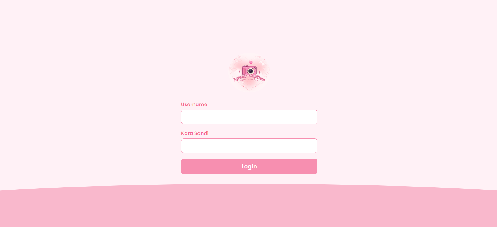
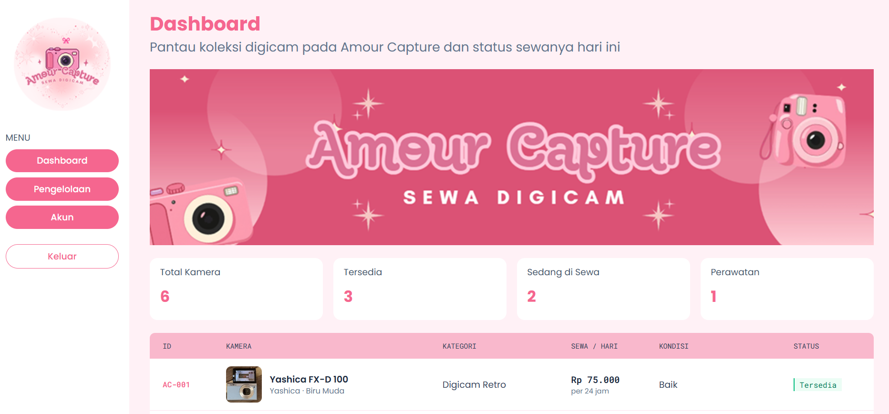
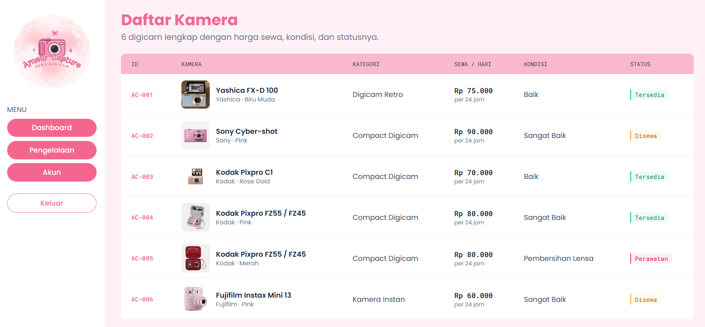
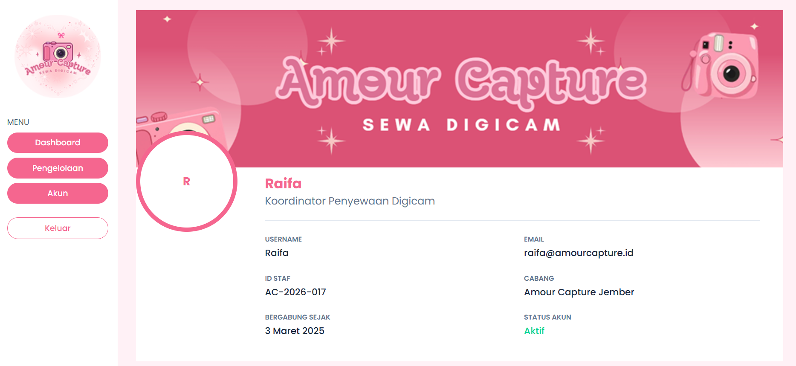

# Amour Capture - Sewa Digicam

Project UTS Pemrograman Web Genap 25/26

- Nama: Raifa Ayla Azzura
- NIM: 252410102020
- Kelas: PWEB A

## Tentang Website
Amour Capture adalah website pengelolaan untuk sewa digicam. Dengan tampilan website berupa
daftar kamera lengkap dengan kategori, harga sewa per hari, kondisi, dan status
unit. Terdapat 3 status yaitu Tersedia, Disewa, dan Perawatan

## Fitur
### Login

Halaman pertama yang akan ditampilkan. Pengguna diminta untuk mengisi username dan password
untuk masuk. Form punya validasi (kolom wajib diisi dan username minimal 3
karakter) dengan pesan error yang tampil di bawah kolom. Setelah lolos validasi,
username dikirim ke halaman dashboard sebagai request parameter lewat URL.

### Dashboard

Halaman utama setelah login. Menampilkan banner Amour Capture, empat kartu
statistik (total kamera, tersedia, sedang disewa, dan perawatan), serta tabel
kamera berisi ID, foto, nama, kategori, harga sewa per hari, kondisi, dan status.

### Pengelolaan

Halaman daftar lengkap seluruh digicam yang tersedia di Amour Capture. Datanya
berasal dari satu sumber yang sama dengan dashboard dan ditampilkan dengan
perulangan @foreach.

### Akun

Halaman profil pengguna. Menampilkan username yang dibawa dari halaman login,
beserta data lain seperti nama, email, peran, ID staf, cabang, dan tanggal
bergabung.